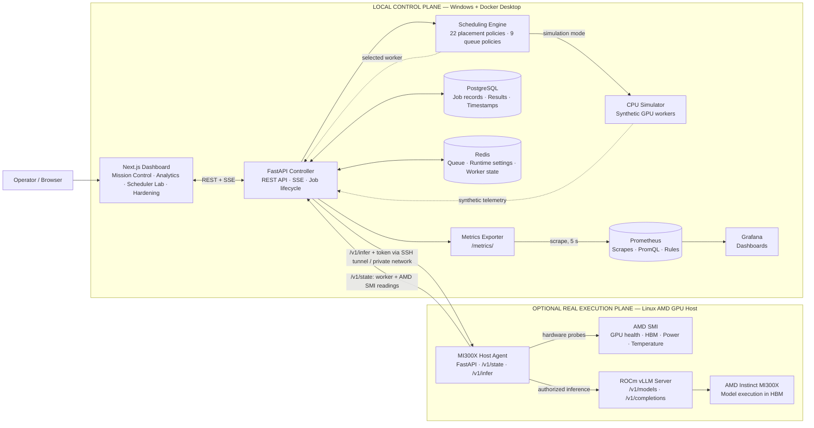
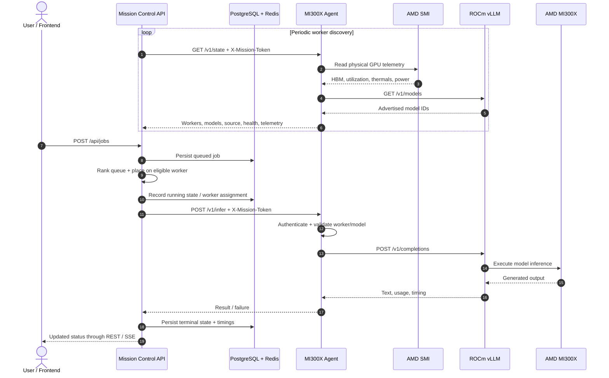
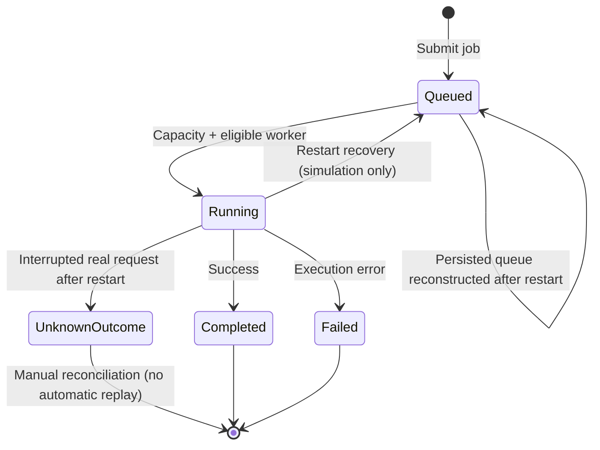

<div align="center">

# AMD AI Factory Mission Control

### Intelligent GPU Workload Scheduling, Inference Orchestration & Observability

**A simulation-first AI inference control plane with validated AMD Instinct MI300X execution, remote GPU telemetry, configurable scheduling, and operational recovery.**


[Overview](#overview) · [Architecture](#system-architecture) · [Quick Start](#quick-start) · [Benchmarks](#experimental-results) · [Observability](#observability) · [Validation](#testing-and-validation) · [Security](#security-and-operational-boundaries)

</div>

> [!IMPORTANT]
> **Project maturity: release candidate / technical demonstration.** The system has been tested with **one real AMD Instinct MI300X serving endpoint** and with multi-worker **CPU simulation**. It is **not** an official AMD product, a Kubernetes GPU operator, or a production-validated multi-GPU orchestration platform. Hardware results and simulated results are identified separately throughout this repository.

---

## Overview

AI inference infrastructure needs more than a model-serving endpoint: operators must determine **which workloads run, when they run, whether capacity is available, and how the system behaves when a worker or controller becomes unavailable**.

**AMD AI Factory Mission Control** addresses this operational layer with a containerized control plane for job admission, non-preemptive queue ordering, worker placement, runtime monitoring, and persisted job outcomes. It supports two explicitly differentiated execution modes:

| Mode | Purpose | Execution / telemetry source | GPU required? |
|---|---|---|---|
| **Simulation** (default) | Local development, scheduler evaluation, demonstrations, controlled fault drills | CPU-generated jobs and **synthetic** GPU utilization/HBM/thermal values | No |
| **MI300X** (opt-in) | Actual language-model inference on an existing AMD GPU server | Remote agent, AMD SMI hardware telemetry, ROCm-compatible vLLM | Yes, separately provisioned |

The local application runs on **Windows + PowerShell + Docker Desktop**. The validated real execution path ran on a separate Linux GPU host; the previously used cloud MI300X does **not** need to remain online for simulation, historical analytics, or dashboard development.

### Key capabilities

- **Workload orchestration:** asynchronous inference job lifecycle, configurable worker capacity, priorities, draining, and job histories.
- **Scheduling framework:** **22 placement strategies** and **9 queue-ordering policies**, including rule-based adaptive placement; no preemption.
- **Dual execution modes:** isolated CPU simulation and authenticated, remote vLLM inference—never silently substitute simulated output for failed real inference.
- **Remote agent:** exposes worker discovery and AMD SMI readings, validates an access token, and forwards selected requests to pre-deployed vLLM servers.
- **Operational observability:** Prometheus scraping and alert rules; Grafana GPU, queue, and scheduling panels; dashboard event updates.
- **Offline analysis:** benchmark history, scheduling-policy experiments, and reliability/hardening views through the installed Phase 7–10 modules.
- **Recovery behavior:** PostgreSQL-backed job records, queue reconstruction on restart, and conservative treatment of interrupted real requests whose outcome is unknown.

## System architecture

The **control plane** owns queue state, scheduling policy, admission decisions, and persisted results. The **execution plane** hosts the model and runs GPU inference. The agent does **not** schedule work globally or create GPU containers: it makes a pre-existing inference endpoint observable and addressable.



**Interpretation:** the scheduler first chooses a ready serving worker, then the backend calls that worker's remote agent. Inference goes through vLLM into ROCm/MI300X. Hardware telemetry comes back through AMD SMI and is surfaced through the API and monitoring stack. A single tensor-parallel vLLM server remains **one schedulable endpoint**, even if it uses multiple physical GPUs.

### Agent request and telemetry lifecycle



> [!NOTE]
> The real agent's `GET /v1/state` and `POST /v1/infer` are token-protected. Its `GET /health` provides an unprotected liveness response. The agent checks vLLM's model registry and uses `/v1/completions` to perform inference. **AMD SMI is a hardware telemetry source, not the inference engine.**

## Technology stack

| Layer | Technologies | Role |
|---|---|---|
| User interface | **Next.js / React / TypeScript** | Live cluster dashboard, job management, benchmark and hardening views |
| Control plane | **Python / FastAPI** | API, runtime configuration, scheduling loop, health/state reconciliation |
| Scheduling | **Python** | Non-preemptive queue ranking and eligible-serving-worker placement |
| Durable records | **PostgreSQL 16** | Job history, outcomes, timestamps, generation metadata |
| Queue / runtime state | **Redis 7** | Queued work and configurable runtime/policy state |
| Hardware adapter | **FastAPI agent + AMD SMI Python bindings** | Remote worker discovery and physical GPU sensor readings |
| Model serving | **vLLM + ROCm** | Model inference on AMD Instinct hardware |
| Monitoring | **Prometheus 3 / Grafana 11** | Time-series scraping, alert rules and operations dashboards |
| Packaging | **Docker Compose** | Local multi-service deployment with persistent volumes |

## Quick start

### Prerequisites

- Windows 11 with **Docker Desktop**, Docker Compose, and **PowerShell** (the demonstrated local workflow).
- Docker Hub access for initial image pulls.
- Python installed locally only if you want to run the standalone benchmark, audit, or release scripts.
- **No GPU, WSL, cloud subscription, or AMD driver installation on the local laptop** is needed for simulation mode.

### 1. Configure local development

From the root of the repository in PowerShell:

```powershell
Copy-Item .env.example .env
notepad .env  # Set local PostgreSQL and Grafana passwords; keep the agent token empty for simulation

docker compose config --quiet
```

`docker-compose.yml` is the primary Compose file in the project. The provided development configuration binds exposed UI/API/monitoring ports to **127.0.0.1**. Do not change them to publicly reachable addresses without adding proper authentication and access control.

### 2. Start the stack

```powershell
docker compose up -d --build
docker compose ps
Invoke-RestMethod 'http://localhost:8000/health'
```

| Service | Local URL | Description |
|---|---|---|
| Mission Control | <http://localhost:3000> | Main dashboard |
| Benchmark Analytics | <http://localhost:3000/benchmarks> | Historical real-GPU benchmark comparisons; installed Phase 7 module |
| Scheduler Lab | <http://localhost:3000/scheduler-lab> | Synthetic queue-policy evaluation; installed Phase 8 module |
| Hardening | <http://localhost:3000/hardening> | Recovery, health, and security views; installed Phase 10 module |
| API docs | <http://localhost:8000/docs> | FastAPI OpenAPI / Swagger UI |
| Prometheus | <http://localhost:9090> | Targets, PromQL and alert rules |
| Grafana | <http://localhost:3001> | GPU / queue / dispatch dashboards |

**Stop without deleting data:**

```powershell
docker compose down
```

> [!CAUTION]
> Avoid `docker compose down -v` unless you intentionally want to remove persistent database, Redis, Prometheus, and Grafana volumes.

### 3. Check the runtime and submit simulated jobs

```powershell
Invoke-RestMethod 'http://localhost:8000/api/runtime' | ConvertTo-Json -Depth 5
Invoke-RestMethod 'http://localhost:8000/api/cluster' | ConvertTo-Json -Depth 7

# Explicitly use the simulator (switch only while there are no active/queued jobs).
Invoke-RestMethod 'http://localhost:8000/api/runtime' -Method Put `
  -ContentType 'application/json' -Body '{"mode":"simulation"}'

# Select a placement policy.
Invoke-RestMethod 'http://localhost:8000/api/policy' -Method Put `
  -ContentType 'application/json' -Body '{"policy":"round_robin"}'

# Submit four synthetic, not GPU-backed, inference jobs.
Invoke-RestMethod 'http://localhost:8000/api/jobs/batch' -Method Post `
  -ContentType 'application/json' `
  -Body '{"model":"model-7b","priority":"normal","prompt_tokens":512,"output_tokens":128,"count":4}'

Invoke-RestMethod 'http://localhost:8000/api/jobs?limit=20' | ConvertTo-Json -Depth 6
```

Simulation jobs use **fabricated workload timings and GPU telemetry**; do not describe them as real MI300X benchmark measurements.

## Operating modes and scheduling

The scheduler contains **22 worker-placement policies** and **9 queue-ordering policies**, for example:

| Concern | Representative policies | Decision |
|---|---|---|
| Placement | Round Robin, Least Connections, Best-Fit Memory, Thermal-Aware, Power-Aware, Adaptive, Auto | **Where** an eligible request should execute |
| Queueing | FCFS, Priority FIFO, Shortest Job First, Priority Aging, Earliest Deadline First, Fair Share | **Which** queued request should execute next |

The `auto` policy is **rule-based**, not a trained reinforcement-learning model. Policies operate subject to worker/model eligibility, health, draining state, memory admissibility, and configured concurrency. Real-hardware validation to date used **one serving endpoint**; it does not establish cross-GPU balancing superiority.

Inspect and change the active policies:

```powershell
Invoke-RestMethod 'http://localhost:8000/api/policies' | ConvertTo-Json -Depth 6

Invoke-RestMethod 'http://localhost:8000/api/queue-policy' -Method Put `
  -ContentType 'application/json' -Body '{"policy":"priority_fifo"}'
```

## Optional: connect a real MI300X server

The execution plane is **separate** from the Windows laptop. A Linux host needs a supported ROCm stack, working AMD SMI access, a running compatible vLLM serving endpoint, and the project's remote Python agent.

1. Deploy and verify ROCm vLLM on the GPU host; confirm its model is advertised through `/v1/models`.
2. Configure the agent's serving-worker mapping, including worker ID, vLLM URL, GPU IDs, and max concurrent jobs.
3. Set a unique `MISSION_AGENT_TOKEN` on the agent and matching backend configuration. **Never paste or commit the token.**
4. Keep the agent bound to loopback/private networking; establish an SSH tunnel or equivalent secure connection from the local control plane.
5. Add the agent URL to your local `.env` (for Docker Desktop, a common tunnel entry is `http://host.docker.internal:9877`), recreate the backend service, and verify worker readiness.
6. Switch runtime mode only after an idle queue and positive AMD SMI/worker-readiness checks.

For the real host setup and exact environment variables, see [MI300X deployment guide](docs/MI300X-DYNAMIC-DEPLOYMENT.md). The previously used MI300X host may have been deprovisioned; these steps require a new authorized GPU host.

> [!WARNING]
> The agent forwards requests to **existing** vLLM instances; it does **not** provision a new GPU VM, start model servers automatically, train models, or manage a Kubernetes cluster.

## Experimental results

### Hardware-validated inference

The following figures are from reported real-inference tests on **one AMD Instinct MI300X** using **Qwen/Qwen3-0.6B** served by ROCm vLLM. The controller was configured with **two concurrent jobs** on the real endpoint. The tests were conducted before the cloud GPU was deprovisioned.

| Experiment | Jobs completed | p95 queue wait | p95 end-to-end latency | Client-observed output throughput |
|---|---:|---:|---:|---:|
| Initial 8-job run | **8 / 8** | 11.2829 s | 12.7369 s | 49.607 tokens/s |
| Optimized 8-job run (v0.5) | **8 / 8** | 4.6745 s | 5.8264 s | 69.661 tokens/s |
| Optimized 16-job run | **16 / 16** | 13.7397 s | 15.3572 s | 75.680 tokens/s |

In the **eight-job before/after comparison**, decoupling telemetry polling from the scheduling loop was associated with:

| Metric | Observed improvement |
|---|---:|
| p95 queue wait | **58.6% lower** |
| p95 end-to-end latency | **54.3% lower** |
| Client-observed throughput | **40.4% higher** |

A separate initial **4/4-job** real test also completed with zero failures, but it used an earlier benchmark calculation; its throughput is **not directly comparable** with the later v2 runs.

### What these numbers do—and do not—mean

- **End-to-end figures include orchestration effects**: queueing, dispatch, networking, state updates, and sampling/polling. They are not standalone GPU silicon benchmarks.
- The 16-job run completed successfully with **13.74-second p95 queue wait**, highlighting the cost of queueing at the configured two-slot concurrency limit.
- The reported p95 agent-to-vLLM call duration was approximately **0.21 seconds** in the v2 tests; this is only one timing boundary, not full client-observed inference latency.
- The initial v0.5 comparison contains **one pre/post run per configuration**; further repeated controlled trials would be needed for statistical confidence.
- AMD SMI HBM observations were **sparse snapshots** (e.g., four polling rows for the 16-job run), not conclusive GPU saturation or peak-memory measurements.
- **One serving endpoint cannot validate multi-worker GPU placement effectiveness.**

### Request-path profiling (v0.6)

A three-trial-per-path experiment measured median client durations of **1.5487 s direct vLLM**, **1.1988 s via the remote agent**, and **1.8450 s through full Mission Control**. These paths were tested sequentially via Windows SSH forwarding, so they are **diagnostic measurements**, not causal proof of per-component overhead or GPU throughput.

### Simulation-only evaluation

The local scheduling-policy lab evaluated **9 queue policies × 4 synthetic workload scenarios × 3 trials = 108 experiments**, with **32 synthetic jobs per experiment**. Local worker draining/resume and controller restart/requeue both passed **6/6 reported checks**. These results must **not** be combined with the physical MI300X results as if they came from the same hardware tests.

For detailed methods and provenance, see [Benchmark methodology](docs/phase11/BENCHMARKS.md) and the curated [reported aggregate dataset](docs/phase11/evidence/benchmark_summary_user_reported.csv). Raw, potentially sensitive runtime artifacts remain in the local `results/` directory and are intentionally excluded from source release archives.

## Observability

Prometheus scrapes the Mission Control backend at **`backend:8000/metrics/`**, using the project configuration's **5-second scrape interval**. Grafana visualizes the exported time-series data. The configuration also loads two **simulation-specific** alert rules:

- `VirtualGPUHighUtilization` — synthetic utilization above 90% for one minute.
- `SimulatedQueueBacklog` — more than 12 pending jobs for one minute.

A local Prometheus validation suite was reported to pass **8/8 checks** (health, target scraping, PromQL, sample presence, and rules loaded), and Grafana panels were observed working. **Alert firing under induced overload and long-term TSDB retention/restart persistence were not independently validated by those checks.**

Useful local checks:

```powershell
Invoke-RestMethod 'http://localhost:9090/-/ready'
Invoke-RestMethod 'http://localhost:9090/api/v1/targets' | ConvertTo-Json -Depth 6

docker compose exec -T prometheus promtool check config /etc/prometheus/prometheus.yml
docker compose exec -T prometheus promtool check rules /etc/prometheus/alerts.yml
```

In Grafana, use the **source labels** to distinguish synthetic `mi300x-sim-*` series from any previously captured real-hardware values. A visible simulation chart is not evidence of an active MI300X machine.

## Reliability and restart semantics



In the validated **simulated** tests, drain/resume preserved active work and resumed queued jobs; controller-restart recovery reconstructed queue entries from persisted job records and completed the test workload. For **real in-flight** requests, a disconnected controller may not know if vLLM already generated a response, so automatic retry is intentionally avoided to reduce duplicate execution risk.

These behaviors are **not** a general exactly-once guarantee, nor a demonstration of real GPU node failover, distributed controller leadership, or recovery from every network partition.

## Testing and validation

The following commands apply to the final locally integrated project with Phase 7–11 tools installed:

```powershell
# Basic service health and backend tests
docker compose ps
Invoke-RestMethod 'http://localhost:8000/health'
docker compose exec -T backend pytest -q

# Phase 11 read-only regression and local security configuration audit
python .\scripts\phase11_regression.py --compose
python .\scripts\audit_phase10_security.py

# Check worker monitoring (read-only)
python .\scripts\monitor_phase10_workers.py --seconds 30

# Verify source-release integrity after packaging
python .\scripts\phase11_release.py --dry-run
python .\scripts\phase11_release.py --version v1.0.0-rc1
python .\scripts\phase11_verify_zip.py .\dist\AMD-AI-Factory-Mission-Control-v1.0.0-rc1.zip
```

**Reported completed checks:** simulated drain/resume **6/6**, simulated restart/recovery **6/6**, local security configuration audit **9/9**, and Prometheus API/configuration validation **8/8**. The security audit is not a penetration test. Disruptive restart/drain drills should run **only while idle** and with appropriate test isolation.

## API reference (selected)

| Method | Endpoint | Function |
|---|---|---|
| `GET` | `/health` | API/database/Redis health |
| `GET` | `/api/cluster` | Worker topology, queue and execution summary |
| `GET` / `PUT` | `/api/runtime` | Inspect/change simulation or MI300X mode |
| `GET` | `/api/models` | Available model registry |
| `GET` | `/api/policies` | List placement and queue policies |
| `PUT` | `/api/policy` | Change placement policy |
| `PUT` | `/api/queue-policy` | Change queue policy |
| `GET` / `POST` | `/api/jobs` | List or create jobs |
| `POST` | `/api/jobs/batch` | Submit multiple jobs |
| `PUT` | `/api/nodes/{node_id}/drain` | Drain or resume a node |
| `GET` | `/api/events/stream` | Server-sent dashboard updates |
| `GET` | `/api/hardening/status` | Phase 10 recovery and worker-health report |
| `GET` | `/metrics/` | Prometheus text exposition |

For complete request/response schemas use [FastAPI OpenAPI docs](http://localhost:8000/docs) on a running local instance.

## Repository layout

```text
.
├── agent/                      # Remote GPU agent and AMD SMI probe
├── backend/
│   ├── app/
│   │   ├── main.py             # FastAPI routes, dispatch loop, APIs
│   │   ├── scheduler.py        # Placement and queue policy implementations
│   │   ├── simulator.py        # Synthetic GPU runtime
│   │   ├── live_runtime.py     # Agent polling / serving worker registry
│   │   └── hardening.py        # Phase 10 recovery / health integration
│   └── tests/
├── frontend/
│   └── src/app/                # Dashboard and optional analytics routes
├── monitoring/
│   ├── prometheus/             # Scrape and alert configuration
│   └── grafana/                # Dashboards and provisioning
├── scripts/                    # Benchmarks, audits, tests, release tooling
├── tests/                      # Release and offline integration tests
├── docs/
│   ├── MI300X-DYNAMIC-DEPLOYMENT.md
│   └── phase11/               # Architecture, benchmark, security, demo docs
├── docker-compose.yml
├── .env.example                # Public template; no live agent token
└── README.md
```

Some modules are installed by the Phase 7–11 add-ons. The above is the **integrated project layout**, not the original v0.3 source-only snapshot.

## Security and operational boundaries

> [!WARNING]
> **For local demos, keep exposed ports bound to loopback. Do not deploy the stack as-is to the public internet.**

- Keep `.env`, actual agent tokens, private keys, database dumps, raw prompt/response histories, and `results/` out of Git.
- The Phase 10 **optional write-token guard** is not the same as comprehensive identity and access management; **GET and SSE endpoints may remain unauthenticated**, and the current UI is not designed to provide write-token headers.
- Protect the agent with its `X-Mission-Token`, plus SSH tunneling or trusted private networking. Avoid public `9877` exposure.
- Change local demonstration passwords before nonlocal deployment, and rotate credentials if previously exposed.
- Prompts and model outputs may be stored in PostgreSQL; establish privacy, retention, and access requirements before accepting sensitive workloads.
- Avoid `docker compose down -v` during ordinary upgrades. A persistent volume is not a substitute for tested backup/restore procedures.
- Run a manual secret review **even if the automated release scanner and configuration audit pass**.

Full operational caveats are in [Security and threat model](docs/phase11/SECURITY.md).

## Releasing and contributing

A release candidate is generated from the actual local working tree, not from a stale download:

```powershell
python .\scripts\phase11_regression.py --compose
python .\scripts\phase11_release.py --dry-run
python .\scripts\phase11_release.py --version v1.0.0-rc1
python .\scripts\phase11_verify_zip.py .\dist\AMD-AI-Factory-Mission-Control-v1.0.0-rc1.zip
```

Before publishing, review `git diff --cached`, verify no credentials or raw user content are staged, and ensure architecture and benchmark claims remain qualified as above. For contributions, use focused changes with passing scheduler/backend tests and clearly labeled simulated or hardware-backed evidence.

### Known limitations and roadmap

- **Validated:** local Compose deployment, simulation, one real MI300X/vLLM endpoint, initial scheduler speedup, simulated draining/restart recovery, monitoring integration.
- **Not yet validated:** multiple *independent* real serving endpoints, production-grade API authentication/authorization, real GPU failure/failover, replicated statistical benchmarks, Prometheus alert firing/persistence, and high-availability controller operation.
- **Future direction:** multi-worker placement experiments, finer-grained vLLM service metrics (TTFT, token-level latency and KV-cache use), policy fairness studies, admission/backpressure controls, hardened security, and integration with external cluster provisioning systems.

## Documentation

| Resource | Focus |
|---|---|
| [Architecture](docs/phase11/ARCHITECTURE.md) | Component responsibilities, agent flow, recovery model |
| [Benchmarks](docs/phase11/BENCHMARKS.md) | Measurements, caveats and evidence provenance |
| [Security](docs/phase11/SECURITY.md) | Boundaries and threats |
| [Demo walkthrough](docs/phase11/DEMO.md) | GPU-free technical demonstration |
| [Release checklist](docs/phase11/RELEASE_CHECKLIST.md) | Reproducible publication gate |
| [MI300X deployment](docs/MI300X-DYNAMIC-DEPLOYMENT.md) | Remote agent and serving-host setup |

## License and attribution

**License pending.** A public GitHub repository is not automatically open source; the project owner should select and add an appropriate `LICENSE` file before announcing an open-source release. This independent project uses AMD Instinct/ROCm technologies but is **not an official AMD product or endorsed GPU-management service**.

---

<div align="center">

**AMD AI Factory Mission Control**  
*Schedule smarter · Observe workloads · Operate with evidence*

</div>
