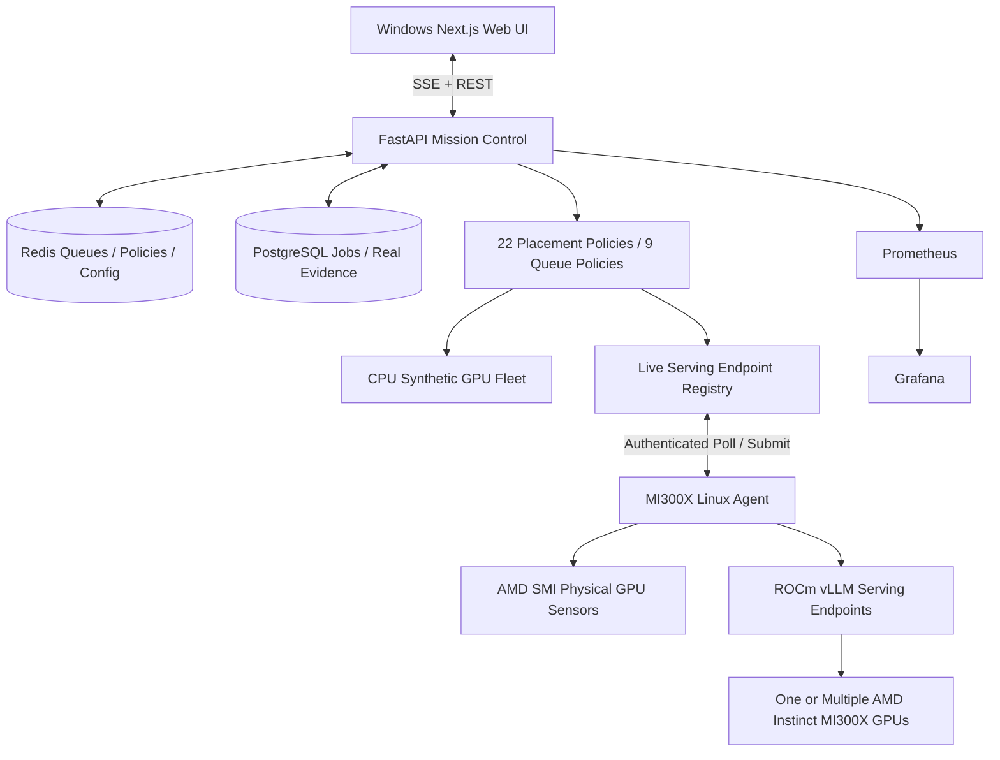

# Dynamic v0.3 System Architecture

**The single most important architectural separation:** the AMD GPU agent reports many physical GPUs, but the scheduler places jobs onto vLLM **serving endpoints**, which may be tensor-parallel groups of GPUs. In this version, the controller does not provision GPU processes, create GPU allocations, or preempt active requests.

- Local dynamic mode can scale virtual nodes at runtime, configure model profiles and run a bounded synthetic workload generator.
- Live real mode discovers vLLM models and hardware sensor values at runtime and blocks operation if telemetry is stale.
- Auto policy switches between least-connections, least-loaded, and adaptive based on the current queue and utilization spread.
- Simulation data and real AMD/vLLM evidence have separate source markers in PostgreSQL, Prometheus and CSV results.
- Runtime switching requires no queued or active jobs; real inference is not automatically retried after a controller restart.
- Real MI300X devices always live on Linux; Windows PowerShell controls the application and optional SSH port forwarding.

See [MI300X-DYNAMIC-DEPLOYMENT.md](MI300X-DYNAMIC-DEPLOYMENT.md) for the actual test procedure and security boundary.
