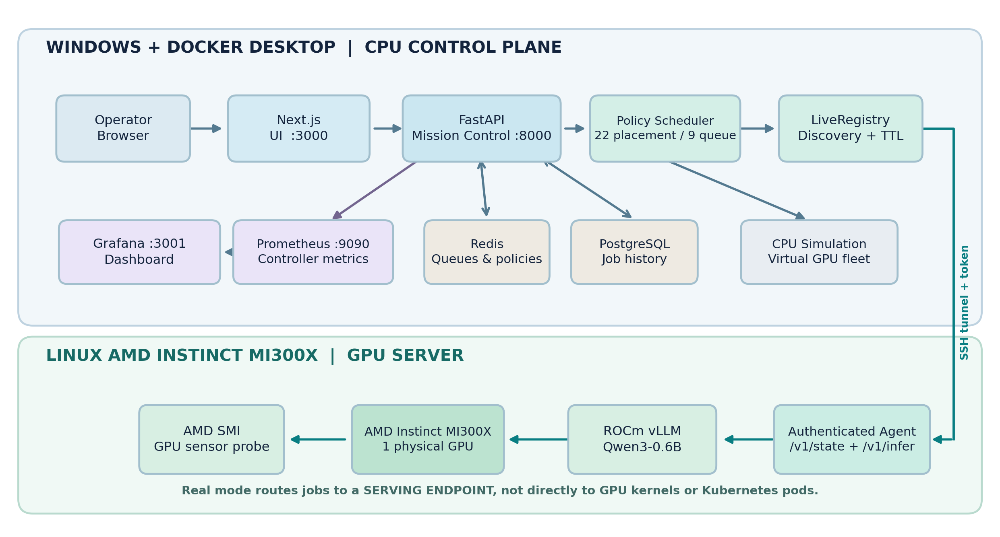
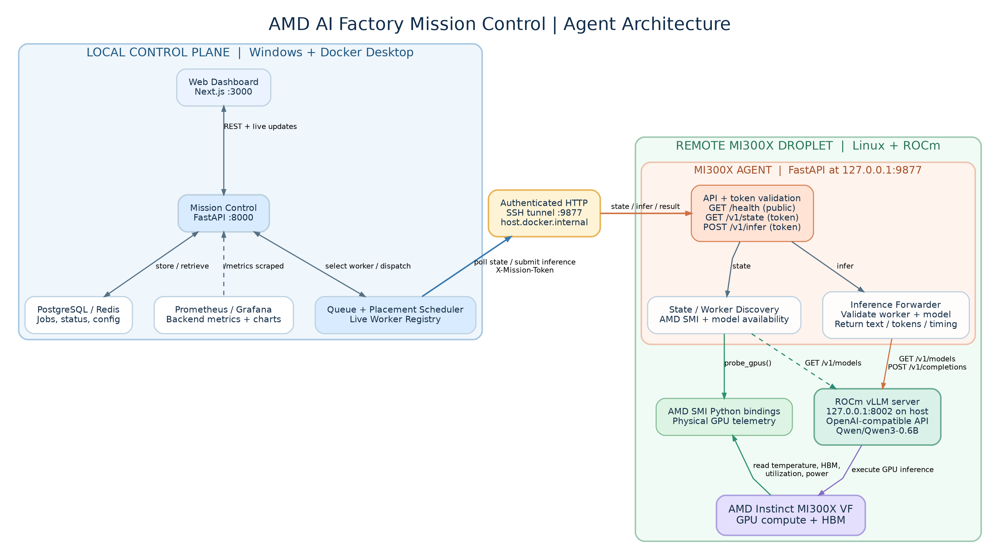

# Architecture and operational flow

## Control plane versus data plane

| Part | Technology | Role |
|---|---|---|
| Frontend | Next.js | Submit/inspect jobs and view simulated/live worker status and historical tests |
| API | FastAPI | Input validation, runtime and policy management, job APIs |
| Scheduler | Python | Rank ready jobs, select eligible workers, enforce configured concurrent slots |
| Durable state | PostgreSQL | Persist job status, timing, prompts and outputs; treat as source of truth on startup |
| Queue state | Redis | Track priority queues and runtime settings |
| Agent | FastAPI on MI300X host | Authenticate protected requests, provide hardware telemetry, forward inference |
| Model server | vLLM + ROCm | Serve `Qwen/Qwen3-0.6B` on MI300X for verified runs |
| Telemetry | AMD SMI + Prometheus/Grafana | Read GPU hardware values and display metrics, subject to sampling limits |

## Agent flow

1. Backend polls authenticated remote `GET /v1/state` for worker details and AMD SMI readings.
2. Scheduler chooses worker placement and dispatches authenticated `POST /v1/infer`.
3. Agent validates token, configured worker and advertised vLLM models (`/v1/models`).
4. Agent calls vLLM's `/v1/completions`. Model execution occurs in ROCm on MI300X.
5. Agent returns generation output, token count, response timing or error; backend updates DB and worker slots.
6. Backend exposes telemetry and job state to Prometheus, Grafana and Next.js.

The remote agent API is **not** a Kubernetes agent, device-level cluster scheduler, or model-training service. The controller controls the queue and worker slots; vLLM manages the inference engine. Live tests used one serving endpoint and one AMD MI300X GPU.

## Restart behavior (simulated)

When a backend restarts, Phase 10 reconciles Redis queues from persisted PostgreSQL job records. A queued job is reconstructed once. Interrupted **simulated** jobs can be returned to the queue. An in-flight **real** request may have already executed remotely, so its outcome is unknown; the backend must **not** silently rerun it, avoiding unintended duplicate inference. This is not a distributed exactly-once guarantee. Verified restart tests used simulated jobs only.

## Environment

Local development used Windows 11 + PowerShell + Docker Desktop. The MI300X agent and ROCm vLLM previously ran on a remote Linux GPU Droplet. The GPU is **not needed** for historical analytics, synthetic scheduler evaluations, monitoring simulation or release packaging.
