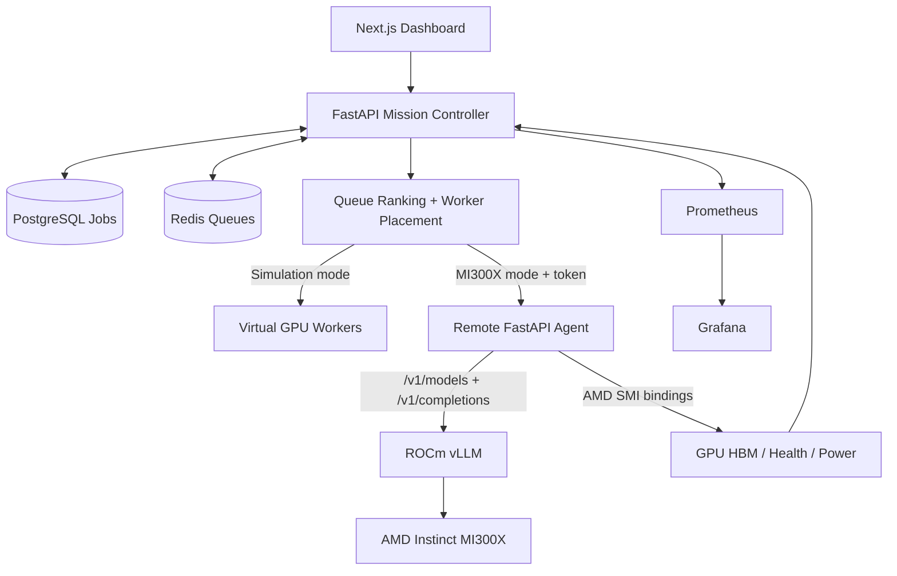

# AMD AI Factory Mission Control

**GPU inference mission control with a local scheduler, observability, CPU simulation, and a validated single-endpoint AMD Instinct MI300X inference integration.**

> **Release status:** v1.0.0 release candidate for local technical demonstration and reproducibility. Not production multi-node orchestration.


## What the system provides

- A **Next.js Mission Control dashboard** and **FastAPI control-plane API**.
- **PostgreSQL** job records and **Redis** scheduling queues.
- Placement and queueing policies, simulation mode, worker health/drain controls and per-job state tracking.
- A remote **FastAPI inference/telemetry agent**, querying **AMD SMI** for hardware metrics and **ROCm vLLM** for model inference.
- **Prometheus + Grafana** for metrics, plus `/benchmarks`, `/scheduler-lab`, and `/hardening` pages where installed.
- GPU-free scheduling-policy studies and local reliability/restart drills.

## Architecture



## Local quick start (Windows PowerShell + Docker Desktop)

Requirements: Docker Desktop, Docker Compose, and Docker Hub access.

```powershell
# Keep the repository's actual .env private and untracked; never publish it.
# If starting from a clean checkout, copy .env.example to .env and configure local secrets.
docker compose up -d --build
docker compose ps
Invoke-RestMethod 'http://localhost:8000/health'
```

Open the **Mission Control UI** at `http://localhost:3000` and **Grafana** at `http://localhost:3001`. The real MI300X worker is optional and will not be available if its cloud VM has been destroyed; local simulation remains the default.

## Demonstrated results and caveats

- **Real hardware**: 4/4, 8/8, and 16/16 inference requests completed successfully using a *single* AMD MI300X vLLM serving endpoint. In the 16-job test the controller configured **two concurrent worker slots**.
- At eight requests, **observed p95 end-to-end latency** dropped **12.7369 s → 5.8264 s (54.3%)** after the v0.5 scheduling loop optimization, based on one pre/post run each.
- **Observed client output throughput** improved **49.607 → 69.661 tokens/s** on that eight-job pre/post comparison, which includes controller, network and polling overhead and is **not raw GPU throughput**.
- The sixteen-job test observed **75.68 client output tokens/s**, with **13.7397 s p95 queue wait**.
- The v0.6 profile found median client latency of **1.5487 s direct vLLM**, **1.1988 s agent**, **1.845 s full control plane** across only three serial trials per path.
- **Simulated reliability**: worker drain/resume **6/6 checks passed**; controller restart/requeue **6/6 passed**. These are not real hardware-failure tests.

Read [Methods and evidence](docs/phase11/BENCHMARKS.md) before quoting performance figures. The curated aggregate data is in `docs/phase11/evidence/`.

## Important boundaries

- One real GPU/serving endpoint does **not** validate multi-GPU placement or load-balancing gains.
- Phase 8 queue-policy comparisons are deterministic **CPU-simulated** experiments; they do not represent physical MI300X scheduling benchmarks.
- The local security audit passing 9/9 checks is a **configuration hygiene check**, not an authentication or penetration-test guarantee. Read endpoints may remain unauthenticated.
- The API includes job prompts and model outputs; do not publicly expose ports without an authenticated gateway and data-handling review.
- The MI300X compute instance may have been destroyed to stop billing. This repo does not include a real GPU emulator; it includes a **simulation**.

## More information

- [Detailed system and agent architecture](docs/phase11/ARCHITECTURE.md)
- [Benchmarks, source boundaries and methodology](docs/phase11/BENCHMARKS.md)
- [Security, limitations and threats](docs/phase11/SECURITY.md)
- [Demo walkthrough](docs/phase11/DEMO.md)
- [Release checklist](docs/phase11/RELEASE_CHECKLIST.md)

**License:** No license is asserted by this autogenerated release kit. The project owner should choose and add a suitable license before public release.
